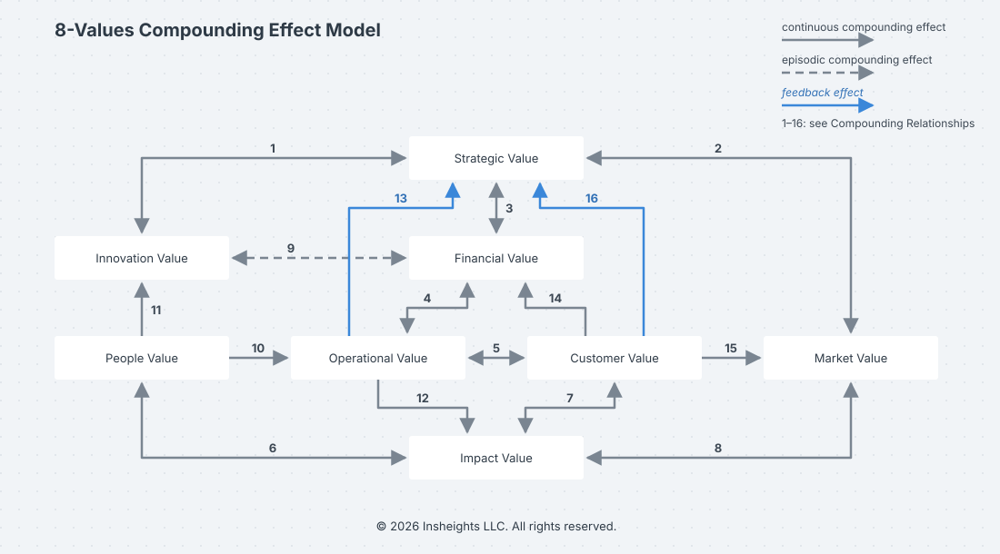

# Insheights 8 Organizational Values Measurement Model

**Customer Value | Financial Value | People Value | Operational Value | Market Value | Strategic Value | Innovation Value | Impact Value**

The organizational value measurement model of the Insheights Integrated Value Creation System, developed by Insheights LLC.

The Insheights 8 Organizational Values Measurement Model defines how the Insheights Integrated Value Creation System generates Organization Value — translating the outcomes of strategy, transformation, and delivery into eight dimensions of value that are expected to compound over time into sustained organizational impact. Each Value is operationally grounded in the IIVCS, behaviorally measured through [Adoption, Engagement, Retention (AER)](aer.md), and delivery-measured through [Efficiency, Experience, Effectiveness (3E)](3e.md).

- **Operational** — each Value is generated through [Organization Strategy Model (OSM)](README.md#osm--organization-strategy-model), [Product Transformation System (PTS)](README.md#pts--product-transformation-system), and [Customer Value Delivery Model (CVDM)](README.md#cvdm--customer-value-delivery-model), not observed from outside
- **Behavioral** — AER operates across two parallel tracks: Customer AER measuring how customers respond to value delivery, and Organizational AER measuring how the delivering organization responds to its own operating model
- **Compounding** — Values are modeled as reinforcing and amplifying each other over time, a reasoned model rather than measured causality (see [Limitations](#limitations))



The 8 Values map to the six capitals of the Integrated Reporting Framework (first issued by the International Integrated Reporting Council, IIRC, and now maintained by the IFRS Foundation) — framing IIVCS operational value generation in terms of the stock of capitals reported to investors and stakeholders.

---

## The Measurement Architecture

The 8 Values sit within a connected measurement architecture. 3E measures how value is delivered and what it achieves — Efficiency and Experience as leading signals, Effectiveness as the lagging outcome signal. AER measures behavioral response to that delivery — across two parallel tracks. The 8 Values measure what the organization generates as a result — across every dimension of organizational life.

```
3E              Efficiency → Experience → Effectiveness
                       ↓   (expected to lead)
Customer AER    Adoption → Engagement → Retention
Org AER         Adoption → Engagement → Retention
                       ↓   (expected to lead)
8 Values        Customer, Financial, People, then the compounding Values
```

3E is expected to lead both AER tracks — Efficiency toward Adoption, Experience toward Engagement, Effectiveness toward Retention — across customer and organizational dimensions. Customer AER is expected to lead Customer and Financial Value, and Organizational AER to lead People Value; both are expected to compound across the remaining Values over time. If an AER stage does not follow its 3E signal, or a Value its AER signal, over three consecutive readings, revisit the link.

See [Insheights AER Behavioral Measurement Model](aer.md). The signals for each Value are listed in [Metrics and Indicators](metrics-and-indicators.md#part-3--8-values-metrics-and-indicators), and the [8 Values Practitioners Guide](guides/8-values-practitioners-guide.md) shows how to build a profile from them.

---

## The Eight Values

---

### 1. Customer Value

**Behavioral Response | Perception | Satisfaction**

The complete measure of value realized by customers — combining behavioral response through Adoption, Engagement, and Retention with customer perception, satisfaction, and trust. Customer Value is the most direct expression of whether the IIVCS is delivering on its promise.

Customer Value has two connected layers:

- **Behavioral** — what customers do: whether they adopt the value offered, engage actively with it, and return over time. Measured through AER — Adoption, Engagement, and Retention — which is expected to translate into growth and revenue
- **Perception** — what customers feel: their satisfaction, confidence, and trust in the value delivered. Measured through 3E Experience — satisfaction, confidence, and Net Promoter (NPS) signals, which record stated feeling and intent

Neither layer is sufficient alone. Behavioral adoption without positive perception is expected to be fragile — customers who use but do not trust are at risk. Positive perception without behavioral engagement is expected to yield little — customers who feel good but do not act generate little value.

Customer Value is primarily generated through CVDM — where every journey step is designed to trigger the right value stage, delivering the value proposition as a realized customer outcome.

| IIVCS Connection | How Customer Value Is Generated |
|---|---|
| **OSM** | Stakeholder and customer expectations shape strategic value priorities — Customer Value starts at strategy |
| **PTS** | Teams organized around customer-facing value streams build the capabilities that serve customer needs |
| **CVDM** | Every journey step triggers the right value stage — delivering outcomes customers adopt, engage with, and return to |
| **3E** | Efficiency is expected to lead Adoption, Experience Engagement, and Effectiveness Retention (revisit after three contrary readings) |

---

### 2. Financial Value

**Current Performance | Forward-Looking Potential**

The measure of current and forward-looking financial performance — encompassing revenue, profitability, margin, unit economics, pipeline, customer lifetime value, and revenue potential. Financial Value is the most visible expression of Organization Value to investors and stakeholders, but it is expected to lag, as an outcome of the other seven Values working together.

Financial Value has two connected layers:

- **Current** — revenue, profitability, gross and net margin, unit economics per customer and per value stream. What the organization is generating now
- **Forward** — pipeline strength, customer lifetime value, revenue potential from existing and new value streams. What the organization is positioned to generate

Financial Value is expected to follow Customer Value — AER readings translating into growth and revenue — and to be amplified by Operational, Strategic, and Innovation Value over time. If Financial Value does not follow Customer AER over three consecutive readings, revisit the link.

| IIVCS Connection | How Financial Value Is Generated |
|---|---|
| **OSM** | Strategic value priorities determine where financial investment generates the greatest return |
| **PTS** | Efficiency as a table stake — transformation that is not cost-effective is expected to erode Financial Value from the start (revisit after three contrary readings) |
| **CVDM** | Delivery learning and performance optimization continuously improve the unit economics of value delivery |
| **3E → AER** | Adoption is expected to lead revenue growth, Engagement revenue depth, and Retention revenue sustainability (revisit after three contrary readings) |

---

### 3. People Value

**Employees | Partners | Contractors | Ecosystem**

The measure of human capability and engagement across the full workforce — employees, leaders, partners, contractors, and ecosystem participants — including culture, growth, and organizational depth. People Value recognizes that value is generated by people, and that the capability and engagement of the full human network determines what the organization can achieve.

People Value has two connected layers:

- **Internal** — employee capability, engagement, culture strength, leadership depth, and organizational learning. The people inside the organization who execute strategy, build product, and deliver value
- **Extended** — partner capability, contractor quality, ecosystem participant engagement. The people outside the organization who extend its reach and amplify its capacity

People Value is most directly shaped by PTS — where [Product Operating Model (POM)](glossary.md#core-system-and-frameworks) Enablers (Leadership, Practices & Behaviors, Organizational Architecture, Culture & Relationships) determine whether the human system is empowered to deliver.

| IIVCS Connection | How People Value Is Generated |
|---|---|
| **OSM** | Strategy that is understood and believed in by people drives engagement and ownership |
| **PTS** | The four POM Enablers — Leadership, Practices & Behaviors, Organizational Architecture, Culture & Relationships — are expected to build People Value |
| **CVDM** | Cross-functional ownership of the full value delivery chain builds capability depth and engagement |
| **3E** | Experience dimension captures whether people feel the culture, growth, and confidence that define People Value (read through eNPS); whether they stay is read from Organizational AER Retention |

---

### 4. Operational Value

**Capability Stock | Execution Quality | Value Stream Performance**

The measure of organizational capability stock, execution quality, and value stream performance — the accumulated processes, systems, and institutional knowledge that enable the organization to consistently and efficiently create and deliver value. Operational Value is the internal engine of the organization — what it has built, how well it runs, and how consistently it delivers.

Operational Value has three connected layers:

- **Stock** — the accumulated capability: processes, systems, tools, institutional knowledge, and technical assets the organization has built over time
- **Execution** — how efficiently and effectively the organization runs: process maturity, system reliability, capability activation quality, and delivery consistency
- **Output** — value stream performance: how consistently and efficiently value streams activate the right capabilities and processes at each journey step

Operational Value is modeled as the base that delivery depends on. Without it, Customer Value is not expected to be delivered consistently, Financial Value to compound, or Strategic Value to be executed. It receives from People Value (one-way) and from Customer and Financial Value (both ways); see the tables below.

| IIVCS Connection | How Operational Value Is Generated |
|---|---|
| **OSM** | Execution & Deployment organized by value stream builds operational capability as a strategic asset |
| **PTS** | The product operating model — capabilities, processes, and team structures — is the primary generator of Operational Value |
| **CVDM** | Delivery learning and performance optimization continuously improve value stream execution quality |
| **3E** | Efficiency is the primary 3E dimension for Operational Value — friction-free execution is both its measure and its output |

---

### 5. Market Value

**Brand | Reputation | Position | Differentiation | Ecosystem**

The externally perceived value of the organization — brand strength, reputation, market position, competitive differentiation, and ecosystem relationships as seen by the market. Market Value is what the market believes the organization is worth and capable of — independent of what it currently delivers. It is expected to be earned through consistent delivery of the other Values and lost through inconsistency, failure, or misalignment.

Market Value has two connected layers:

- **Brand and reputation** — the perception of the organization's identity, trustworthiness, and quality in the minds of customers, partners, and the market
- **Position and ecosystem** — the organization's standing relative to competitors, its differentiation, and the strength of its partner and ecosystem relationships

Market Value is expected to amplify the other Values — strong market position is expected to make Customer Value easier to earn, Financial Value easier to sustain, and Strategic Value easier to execute. It is both an outcome of the other Values and an input to them.

| IIVCS Connection | How Market Value Is Generated |
|---|---|
| **OSM** | Vision and mission, consistently executed, build the brand narrative that generates Market Value |
| **PTS** | Consistent delivery of quality through the product operating model builds reputational credibility |
| **CVDM** | Customer experience and satisfaction signals aggregate into brand perception and market reputation |
| **3E → AER** | Retention and referral (Customer AER Recommendation) from satisfied customers are expected to generate Market Value (revisit after three contrary readings) |

---

### 6. Strategic Value

**Formulation Quality | Execution Effectiveness | Agility | Risk**

The measure of strategy formulation quality and execution effectiveness — how clearly direction is set, how well strategy translates to outcomes, and how effectively the organization manages agility and risk. Strategic Value recognizes that strategy is both an asset — when it is clear, well-formed, and believed in — and a liability when it is unclear, static, or disconnected from execution reality.

Strategic Value has two connected layers:

- **Formulation** — the quality of strategic direction: clarity of vision and mission, relevance of value priorities, strength of strategic hypotheses, and quality of stakeholder alignment
- **Execution** — how well strategy translates to outcomes: execution quality, portfolio performance, organizational agility in responding to change, and risk management effectiveness

Strategic Value is most directly generated by OSM — where strategic intent is formed, tested, and continuously refined through a feedback loop between governance and execution.

| IIVCS Connection | How Strategic Value Is Generated |
|---|---|
| **OSM** | Strategic Value Creation — informed by internal/external context, stakeholder expectations, and enterprise risk — is the primary generator of Strategic Value |
| **PTS** | Strategy becomes executable through the product operating model — PTS tests whether strategic intent can be operationalized |
| **CVDM** | Strategic signals feedback loop returns delivery outcomes upstream — customer reality continuously refines strategic direction |
| **3E** | Effectiveness is the primary 3E dimension for Strategic Value — outcomes achieved test strategic hypotheses |

---

### 7. Innovation Value

**Current IP | R&D Effectiveness | Capability Expansion | Future Value Streams**

The measure of current and forward-looking value creation — existing intellectual property, R&D effectiveness, capability expansion, and the new value streams and products being built for the future. Innovation Value is the organization's capacity to create value it does not yet deliver — the pipeline of future Organization Value being built today.

Innovation Value has two connected layers:

- **Current** — existing IP, R&D in progress, capability expansion underway, and innovations being brought to market now
- **Forward** — new value streams being designed, future products and services in discovery, and the organizational capacity to continue creating new value

Innovation Value is most directly generated by PTS — where the Discover phase continuously explores new value opportunities, and the full product lifecycle from Discover through Support creates the conditions for innovation to compound.

| IIVCS Connection | How Innovation Value Is Generated |
|---|---|
| **OSM** | Strategic value priorities determine where innovation investment is directed — Innovation Value starts with strategic intent |
| **PTS** | Continuous discovery, hypothesis-driven thinking, and the full product lifecycle from Discover through Support generate Innovation Value |
| **CVDM** | Journey insights and delivery learning surface unmet customer needs — the raw material of Innovation Value |
| **3E** | Effectiveness measures whether innovation is generating real outcomes — not just activity |

---

### 8. Impact Value

**Mission | ESG | Society | Environment | Community**

The measure of value generated beyond commercial interest — mission advancement, ESG performance, and contribution to society, community, and the environment. Impact Value recognizes that organizations exist within and affect a broader system, and that the value they generate — or destroy — beyond their commercial boundaries is a genuine dimension of Organization Value.

Impact Value has two connected layers:

- **Internal** — mission advancement and ESG performance: how well the organization lives its stated purpose, manages its environmental footprint, and governs itself with integrity
- **External** — societal, environmental, and community contribution: the value generated for people and systems beyond the organization's direct commercial interest

Impact Value is not separate from the other Values — it is expected to be amplified by them and to amplify them in return. Organizations with strong Impact Value are expected to attract better people (People Value), stronger market position (Market Value), and greater stakeholder trust (Customer and Financial Value).

| IIVCS Connection | How Impact Value Is Generated |
|---|---|
| **OSM** | Values, Mission, and Vision — the foundation of OSM — set the direction for Impact Value at the strategic level |
| **PTS** | Culture & Relationships as a POM Enabler shapes whether teams operate with the integrity and purpose that generates Impact Value |
| **CVDM** | The experience customers, partners, and communities have with the organization's delivery defines its societal reputation |
| **3E** | Experience and Effectiveness together measure whether the organization's impact is felt and realized — not just intended |

---

## Compounding Relationships

The 8 Values are modeled not as a linear chain but as a network in which most values are convergence nodes, receiving from and generating into multiple other values simultaneously. See the diagram at the top of this document.

**Arrow encoding:**
- **Solid arrows** — modeled as a direct, continuous relationship: expected to be active, ongoing, and traceable
- **Dashed arrows** — modeled as an indirect, episodic relationship: mediated or periodic rather than immediate
- **Arrowheads** — one head for a one-way relationship, a head at each end for a two-way relationship
- **Labels** — a one-way arrow carries a verb, read from source to target (*Customer Value **builds reputation** for Market Value*); a two-way arrow names what passes both ways (*capital allocation* between Strategic and Financial Value). Each label summarizes a row in the tables below

Every row in these tables is an expected relationship, not a measured one; the short form in each table's first column applies to every row.

### Bidirectional Relationships — Solid

| Relationship (revisit after three contrary readings) | Direction A | Direction B |
|---|---|---|
| **Strategic ↔ Innovation** | Strategic direction sets where innovation investment is focused | Disruptive innovation reshapes strategic direction |
| **Strategic ↔ Market** | Strategic choices shape market positioning and competitive strategy | Market signals inform strategic reassessment |
| **Strategic ↔ Financial** | Strategic direction determines capital allocation and resource deployment | Financial performance informs strategic capacity and priority |
| **Financial ↔ Operational** | Financial returns fund operational investment and capability improvement | Operational efficiency and throughput generate financial returns |
| **Operational ↔ Customer** | Operational capability enables consistent customer value delivery | Customer signal and demand drive operational improvement and redesign |
| **People ↔ Impact** | People capability and culture generate societal and ecosystem impact | Purpose and impact attract, engage, and retain people |
| **Customer ↔ Impact** | Delivering genuine customer value creates direct societal benefit | Impact purpose deepens customer loyalty and advocacy |
| **Market ↔ Impact** | Market reach and reputation amplify societal and ecosystem impact | Strong impact builds market reputation and trust |

### Bidirectional Relationship — Dashed

| Relationship (revisit after three contrary readings) | Direction A | Direction B |
|---|---|---|
| **Innovation ↔ Financial** | Innovation generates financial return through new products, IP, and market expansion — over time and through the operational chain | Financial strength funds R&D, experimentation, and innovation infrastructure |

The Innovation ↔ Financial relationship is indirect and episodic: financial return from innovation routes through operations and customer delivery rather than immediately, and financial investment in innovation produces returns on a cycle rather than continuously.

### One-Way Relationships

| Relationship (revisit after three contrary readings) | Type | Mechanism |
|---|---|---|
| **People → Operational** | Foundational | People capability is expected to be the prerequisite for operational performance |
| **People → Innovation** | Foundational | People capability and engagement drive innovation capacity |
| **Operational → Impact** | Generative | How the organization operates directly creates or undermines societal and ecosystem impact |
| **Operational → Strategic** | Feedback | Operational capability and capacity inform strategic feasibility — what the organization can actually execute |
| **Customer → Financial** | Generative | Customer value delivery generates revenue, margin, and financial sustainability |
| **Customer → Market** | Generative | Consistent customer outcomes build market reputation and position |
| **Customer → Strategic** | Feedback | Customer outcomes are evidence for whether strategic hypotheses hold |

### Convergence Nodes

Every value except People receives inputs from multiple sources — making it a convergence node where different streams compound into a single dimension.

| Node | Receives from |
|---|---|
| **Strategic** | Innovation, Market, Financial *(bidirectional)* + Operational, Customer *(one-way)* |
| **Financial** | Customer *(one-way)* + Strategic, Operational *(bidirectional)* + Innovation *(dashed)* |
| **Operational** | People *(one-way)* + Customer, Financial *(bidirectional)* |
| **Customer** | Operational *(bidirectional)* + Impact *(bidirectional)* |
| **Market** | Customer *(one-way)* + Strategic, Impact *(bidirectional)* |
| **Innovation** | People *(one-way)* + Strategic *(bidirectional)* + Financial *(dashed)* |
| **Impact** | Operational *(one-way)* + People, Customer, Market *(bidirectional)* |
| **People** | Impact *(bidirectional)* |

**In the model, People Value is the source node** — it receives from one value only (Impact), so it is where value is modeled as originating without a dominant upstream driver. Every other value synthesizes inputs from multiple sources and radiates back into the system.

---

## 8 Values and IR 6 Capitals — The Bridge

The Insheights 8 Values model is the operational measurement layer of the IIVCS — measuring how value is generated through strategy, transformation, and delivery. It maps to the six capitals of the Integrated Reporting Framework (IIRC, now maintained by the IFRS Foundation), framing operational value generation in terms of the stock of capitals reported to investors and stakeholders.

The bridge is directional — 8 Values measure the flow of value generation; IR 6 Capitals measure the resulting stock of value held.

| Insheights 8 Values | IR 6 Capitals | Translation |
|---|---|---|
| **Customer Value** | Social & Relationship Capital | Customer behavioral response and perception builds the relationship capital stock |
| **Financial Value** | Financial Capital | Current and forward-looking financial performance builds the financial capital stock |
| **People Value** | Human Capital | Workforce capability and engagement across employees, partners, and ecosystem builds the human capital stock |
| **Operational Value** | Manufactured + Intellectual Capital | Capability stock, systems, and institutional knowledge maps to both manufactured and intellectual capital |
| **Market Value** | Social & Relationship Capital | Brand, reputation, and ecosystem relationships build the externally perceived relationship capital stock |
| **Strategic Value** | Intellectual Capital | Strategy formulation quality and execution effectiveness builds intellectual and organizational capital |
| **Innovation Value** | Intellectual Capital | IP, R&D, and future value streams are the intellectual capital pipeline |
| **Impact Value** | Natural + Social & Relationship Capital | Mission, ESG, and societal contribution maps to natural capital and to social and relationship capital |

The bridge lets organizations using the IIVCS frame operational value generation in IR-compatible terms — connecting delivery metrics to board and investor-level reporting. It is framing, not an audited translation (see [Limitations](#limitations)).

---

## 8 Values and the IIVCS Frameworks

Each IIVCS framework generates value across multiple dimensions simultaneously. The 8 Values make that generation visible and measurable.

| Value | OSM | PTS | CVDM |
|---|---|---|---|
| **Customer Value** | Sets customer-facing priorities | Builds customer-serving capabilities | Delivers customer outcomes |
| **Financial Value** | Directs investment to highest return | Manages transformation cost efficiency | Optimizes delivery unit economics |
| **People Value** | Aligns people to strategic direction | Empowers cross-functional teams | Builds delivery capability depth |
| **Operational Value** | Organizes execution by value stream | Builds the product operating model | Measures value stream performance |
| **Market Value** | Shapes brand through vision and mission | Builds reputational credibility through delivery | Generates advocacy through customer experience |
| **Strategic Value** | Primary generator — strategy formation and testing | Tests whether strategy is executable | Returns customer reality to strategic reassessment |
| **Innovation Value** | Directs innovation investment | Primary generator — continuous discovery and delivery | Surfaces unmet needs as innovation inputs |
| **Impact Value** | Sets mission and purpose | Builds culture of integrity and purpose | Delivers impact through customer and community experience |

---

## Feedback

The 8 Values metrics surface organizational outcomes back to OSM's Governance & Measurement and PTS's operating model — forming the organizational feedback layer of the IIVCS. See [IIVCS Feedback System](feedback.md).

---

## Limitations

The 8 Values is a synthesis model — it reads across 3E and AER signals and infers organizational value. That makes it the most assumption-heavy layer of the architecture:

- **Heaviest instrumentation demand.** A credible 8 Values profile presumes 3E and AER signals already exist across architecture elements and both tracks. On a first run, most organizations will find several values unmeasured — the [practitioner guide](guides/8-values-practitioners-guide.md#step-1--separate-measured-values-from-assumed-values) treats this as the expected starting finding. Until the signals exist, parts of the profile are informed assumption, not measurement.
- **Compounding relationships are a model, not measured causality.** The directional and bidirectional relationships across the network are a reasoned diagnostic model for tracing root cause — not a statistically established set of causal links. Use them to form hypotheses, then verify; do not report the arrows as proven. Each link on this page is stated with what would count against it: if the next signal does not follow over three consecutive readings, revisit the link.
- **The IIVCS connection tables describe design, not tested links.** Each Value's table of how OSM, PTS, CVDM, 3E and AER generate it states how the system is meant to work. Read each row as an expected link under the same revisit rule.
- **The IR 6 Capitals bridge is many-to-many.** Several values map to the same capital (Customer + Market + Impact → Social & Relationship; Operational + Strategic + Innovation → Intellectual). Rolling values up to capitals without an agreed aggregation convention risks double-counting. The bridge enables IR-compatible *framing*; it is not an audited translation.
- **A value's status rests on the signals chosen for it.** The status follows a stated rule (the weakest signal decides; the statuses and the rule are set out in [Step 3 of the practitioner guide](guides/8-values-practitioners-guide.md#step-3--build-the-value-profile-and-read-the-compounding-relationships), from the [bands in Metrics and Indicators](metrics-and-indicators.md#how-to-read-this-guide)), so two readers of the same signals reach the same status. Which signals represent a value is still a judgment: name them before reading them. The model supplies structure and discipline — not objectivity.
- **Not an external reporting standard.** The 8 Values is an internal, operational measurement model. It does not replace audited financial statements, ESG/GRI disclosure, or IR assurance — it produces the operational data that feeds them.
- **No external benchmarks.** Like 3E and AER, the 8 Values has no published industry reference ranges; compare a value against its own baseline over time, not against peers.

**When not to use it:** as a board scorecard before the underlying signals exist; or as a substitute for statutory or ESG reporting. Where a value has no traceable operational source yet, report it as unmeasured, not as a status, and start with the values that have one (see *Heaviest instrumentation demand*, above).

---

## Summary

Organization Value is not a single metric — it is the sum of eight interconnected dimensions generated through every act of strategy, transformation, and delivery across the IIVCS.

Customer Value and Financial Value are the most visible — the behavioral and financial readings of whether the system is working. People Value and Operational Value are the engine — the human and capability foundation that makes sustained delivery possible. Market Value and Strategic Value are the multipliers — amplifying what is built and directing where it goes next. Innovation Value and Impact Value are the future — ensuring the organization continues to create value beyond what it delivers today.

The relationships run in all directions. Most values are convergence nodes — receiving from and generating into multiple others simultaneously. Strategic Value synthesizes signal from Innovation, Financial, Operational, Customer, and Market to continuously refine direction. Financial Value accumulates from Operational and Customer performance and feeds back into Operational, Strategic, and Innovation Value. Impact Value connects People, Operational, Customer, and Market into a single dimension of societal and ecosystem return. In the model, People Value is the source node — through capability and purpose, it is expected to set the others in motion. No dimension stands alone — each generates and is generated by the others.

Measured through 3E, expressed behaviorally through AER, and bridged to IR 6 Capitals for external reporting, the Insheights 8 Values model is how the IIVCS is designed to make Organization Value visible, measurable, and continuously improvable. Its links are expected, not proven: if the next signal does not follow over three consecutive readings, revisit the link.

---

© 2026 Insheights LLC. All rights reserved.
